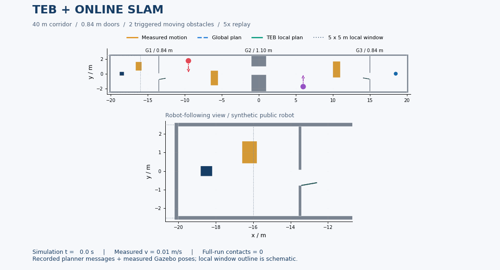
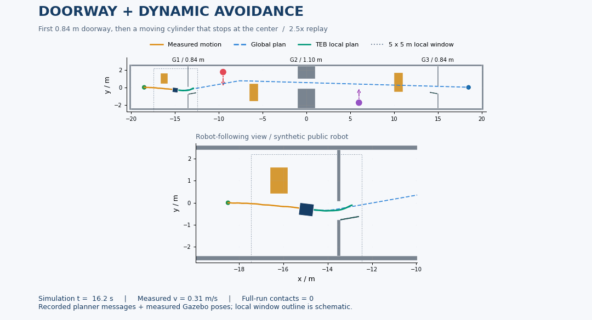
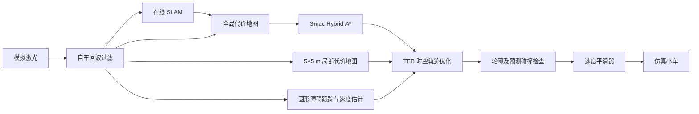

# TEB × Nav2 · 在线建图与动态避障

ROS 2 Humble / Gazebo Classic / slam_toolbox / Smac Hybrid-A* / TEB

在 **40 米长走廊**里完成在线建图、窄门通过、静态绕障和动态避障。
全局地图由激光在线建立，局部采用 **5 × 5 m 滑动代价地图**；不加载预制场景地图。

> 公开版使用从零编写的几何小车，只有方块、圆柱和球体。**不含实车 URDF、STL、CAD、传感器安装坐标或其派生模型资料。**
> 动图和本页结果来自公开模型的仿真实验，不代表任何实车性能。[资产来源与边界](docs/PUBLIC_ASSETS.md)



**蓝色虚线：全局规划 · 绿色：TEB 局部规划 · 橙色：实际行驶轨迹。**
上图为 5 倍速实测数据回放；灰色虚线框示意局部窗口，不是代价栅格截图。
画面里的路径来自实际 ROS 规划消息，物体位置来自 Gazebo 测量。

## 窄门与动态障碍



第一道门的门框内宽 **0.84 m**，门扇从右侧向终点方向打开 80°。
小车通过后触发红色圆柱：圆柱从侧面走到走廊中心并停下，要求规划器根据观测持续绕行。
局部放大回放为 2.5 倍速。

| 场景部分 | 配置 |
| --- | --- |
| 走廊 | 40 × 4.8 m，起点到终点 37 m |
| 首末门 | 门框内宽 0.84 m，门扇厚 0.035 m，开角 80° |
| 中段通道 | 宽 1.10 m、长 2 m |
| 静态障碍 | 3 个向左右错开的箱体 |
| 红柱 / 紫柱 | 半径 0.40 m，速度 0.55 / 0.50 m/s，独立位置触发 |
| 公开示例小车 | 0.60 × 0.52 m 外包络，规划轮廓另含每侧 2 cm 裕量 |
| 局部 / 全局代价地图 | 0.02 / 0.025 m 栅格；全局融合在线 SLAM |

## 快速运行

推荐使用 Docker：将 Humble 与宿主机已有的其他 ROS 版本隔离。
宿主机需要 Docker、Git；GUI 还需要本地图形会话与 `xauth`。

```bash
git clone https://github.com/Asukaandmeaaa/teb-nav2-humble-demo.git
cd teb-nav2-humble-demo

# 首次执行：准备镜像并编译六个依赖/演示包
./scripts/sim.sh image
./scripts/sim.sh build

# 终端 1：保持运行，打开 Gazebo 和 RViz
./scripts/sim.sh gui
```

在另一个终端进入仓库目录：

```bash
./scripts/sim.sh trial
```

脚本自动进入容器，等待时钟、激光、在线地图和 Nav2 就绪，再发送场景终点。
终端每 5 秒输出进度，结束后给出结果摘要；完整 JSON 和轨迹 CSV 保存在 `results/`。

```bash
./scripts/sim.sh status        # 通信及起点检查，不发送目标
./scripts/sim.sh resume        # 恢复被暂停的物理仿真
./scripts/sim.sh stop          # 结束本轮
./scripts/sim.sh restart gui   # 重建场景和在线地图，解决旧容器占用及非初始场景
```

`gui` 占用当前终端，`trial` 应在第二个终端执行。无需手动进入容器。
`SCENARIO_NOT_FRESH` 表示尚未发送目标：起点偏差超过 15 cm，或动态障碍已经触发。
执行 `restart gui` 后重新测试；继续等待或 `resume` 不会重置场景。
暂时不用时执行 `stop`，避免物理仿真长时间空跑后的漂移。

无图形界面时使用 `./scripts/sim.sh start`，再运行 `trial`。
局部窗口可以调整，例如：

```bash
./scripts/sim.sh restart gui local_map_size:=5 local_map_resolution:=0.02
```

窄门测试建议保留 0.02 m 局部栅格；0.1 m 对门框和薄门扇过于粗糙。
GUI 默认使用软件渲染并限制 Mesa 渲染线程，可用 `SIM_RENDER_THREADS=4` 覆盖。

## 实现要点



- **清除移动障碍残留：** 局部地图只使用实时激光及其保留观测，不叠加 SLAM 历史层。全局激光层的已观测空闲格可覆盖旧占用；未知区域不作空闲清除。
- **处理扫描与 TF 到达顺序：** 最多等待 0.25 s 的对应时间戳 TF；跟踪结果 0.6 s 无更新即清空，避免规划器无限沿用旧预测。自车遮挡回波设为 NaN，不误清障碍。
- **窄门规划：** Hybrid-A* 考虑朝向及完整多边形轮廓；TEB 使用密集路径引导点。优化失败时等待重规划，避免默认盲转/倒车恢复。
- **动态安全检查：** 软避障代价之外，在轨迹采样点检查跟踪障碍的预测位置，再下发速度。预测采用观测速度，不预知未来动作。
- **响应与平滑：** 局部地图更新 20 Hz，全局更新 5 Hz，重规划 2 Hz，速度平滑 40 Hz；这些是配置频率，并不保证所有计算都在周期内结束。
- **成本图补丁：** Nav2 1.1.20 的轮廓检查优先保留致命障碍结果，避免另一条边的未知格掩盖碰撞。[来源和补丁说明](src/nav2_costmap_2d/UPSTREAM.txt)

## 生成动图与检查

可选绘图依赖：`python3-numpy python3-matplotlib python3-pil`。

```bash
# 自动启动全新无界面场景、测试、生成轨迹图/GIF，然后停止容器
# 已有场景请先执行 ./scripts/sim.sh stop
./scripts/sim.sh corridor --gif

# 使用一份真实测试报告生成 README 风格动图
python3 scripts/render_readme.py \
  --trial results/你的测试目录/trial_时间_teb_UTC.json \
  --output results/readme_preview

# 查看 README 所用的公开实验数据
python3 scripts/render_readme.py --trial docs/data/corridor_run.json --output results/replay
```

生成的 world 仅是物理测试环境，不作为导航先验地图。
场景和公开模型均可以重新生成：

```bash
python3 scripts/generate_scenes.py
python3 scripts/generate_demo_robot.py
./scripts/sim.sh build
```

代码检查在已构建、正在运行的容器中执行：

```bash
./scripts/sim.sh shell
python3 -m unittest discover -s /workspace/src/dynamic_nav_sim/test -v
```

发布前可检查暂存内容：`python3 scripts/check_public_assets.py`。
原始结果目录、构建输出和私有模型文件默认忽略。

## 代码入口

| 路径 | 用途 |
| --- | --- |
| `src/dynamic_nav_sim/` | 新的在线建图、动态场景、跟踪和评测包 |
| `src/dynamic_nav_sim/config/nav2_responsive_doors.yaml` | 默认走廊规划参数 |
| `src/dynamic_nav_sim/scripts/scan_obstacle_tracker.py` | 激光圆形障碍跟踪 |
| `src/teb_local_planner/` | Humble TEB 及动态碰撞/比例限速/计时补丁 |
| `src/nav2_costmap_2d/` | Nav2 1.1.20 轮廓碰撞检查修复覆盖包 |
| `scripts/` | Docker 操作、资产生成、测试与动图 |
| `src/teb_nav2_demo/` | 原有静态地图演示，仍保留 |

原项目的静态地图、AMCL 和 planning-only 使用方法见 [原版说明](docs/LEGACY_DEMO.md)；
详细历史排障见 [TEB_HUMBLE_REPRO.md](TEB_HUMBLE_REPRO.md)。
新脚本和 `dynamic_nav_sim` 使用 Apache-2.0；第三方代码保留原许可证，见 [NOTICE](NOTICE)。
